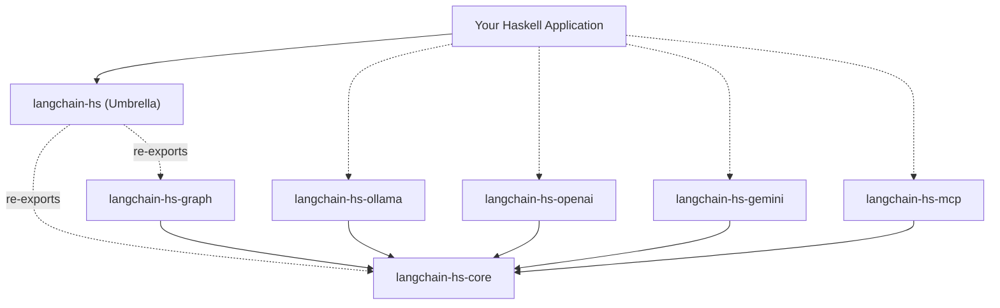

## Monorepo Breakdown

The `langchain-hs` ecosystem is organized into modular packages to ensure a lightweight core and optional, decoupled provider integrations:

| Package | Version | Hackage | Source | Description |
|---|---|---|---|---|
| **`langchain-hs-core`** | `0.0.6.0` | [Hackage ↗](https://hackage.haskell.org/package/langchain-hs-core) | [`./langchain-hs-core`](https://github.com/tusharad/langchain-hs/tree/develop/langchain-hs-core) | Core framework: AST pipelines (`RunnableTree`), `ChatModel`, `Tool`, agents (`ReAct`, `PlanAndExecute`), output parsers, vector stores, retrievers, memory, cache, guardrails, resilience, observability, and canonical `Langchain.Prelude`. |
| **`langchain-hs-graph`** | `0.0.6.0` | [Hackage ↗](https://hackage.haskell.org/package/langchain-hs-graph) | [`./langchain-hs-graph`](https://github.com/tusharad/langchain-hs/tree/develop/langchain-hs-graph) | Production state machines: `StateGraph s m`, `StateReducer s`, sub-graphs (`addSubGraphNode`), `runnableNode`, `chatModelNode`, Checkpointers (STM & SQLite), HITL, TimeTravel, Graphviz DOT export. |
| **`langchain-hs`** | `0.0.6.0` | [Hackage ↗](https://hackage.haskell.org/package/langchain-hs) | [`./`](https://github.com/tusharad/langchain-hs) | Umbrella package re-exporting `langchain-hs-core` and `langchain-hs-graph` via Cabal `reexported-modules`. |
| **`langchain-hs-ollama`** | `0.0.6.0` | [Hackage ↗](https://hackage.haskell.org/package/langchain-hs-ollama) | [`./langchain-hs-ollama`](https://github.com/tusharad/langchain-hs/tree/develop/langchain-hs-ollama) | Dedicated Ollama provider and embeddings integration via `ollama-haskell`. |
| **`langchain-hs-openai`** | `0.0.6.0` | [Hackage ↗](https://hackage.haskell.org/package/langchain-hs-openai) | [`./langchain-hs-openai`](https://github.com/tusharad/langchain-hs/tree/develop/langchain-hs-openai) | Dedicated OpenAI & OpenAI-compatible provider, streaming, and embeddings via `openai`. |
| **`langchain-hs-gemini`** | `0.0.6.0` | [Hackage ↗](https://hackage.haskell.org/package/langchain-hs-gemini) | [`./langchain-hs-gemini`](https://github.com/tusharad/langchain-hs/tree/develop/langchain-hs-gemini) | Dedicated Google Gemini client & LangChain provider. Servant bindings over Interactions v1 OpenAPI spec, `ChatModel`, `ToolBinder`, `gemini-embedding-001`, and SSE streaming. |
| **`langchain-hs-mcp`** | `0.0.6.0` | [Hackage ↗](https://hackage.haskell.org/package/langchain-hs-mcp) | [`./langchain-hs-mcp`](https://github.com/tusharad/langchain-hs/tree/develop/langchain-hs-mcp) | Model Context Protocol client over stdio and HTTP JSON-RPC 2.0. |

---

## Dependency Graph

---

## Community & Feedback

- **GitHub Issues**: [github.com/tusharad/langchain-hs/issues](https://github.com/tusharad/langchain-hs/issues)
- **Discord Community**: [Join the Discord Server](https://discord.gg/swpKq59RJA)
- **Maintainer**: Tushar Adhatrao `<tusharadhatrao@gmail.com>`
