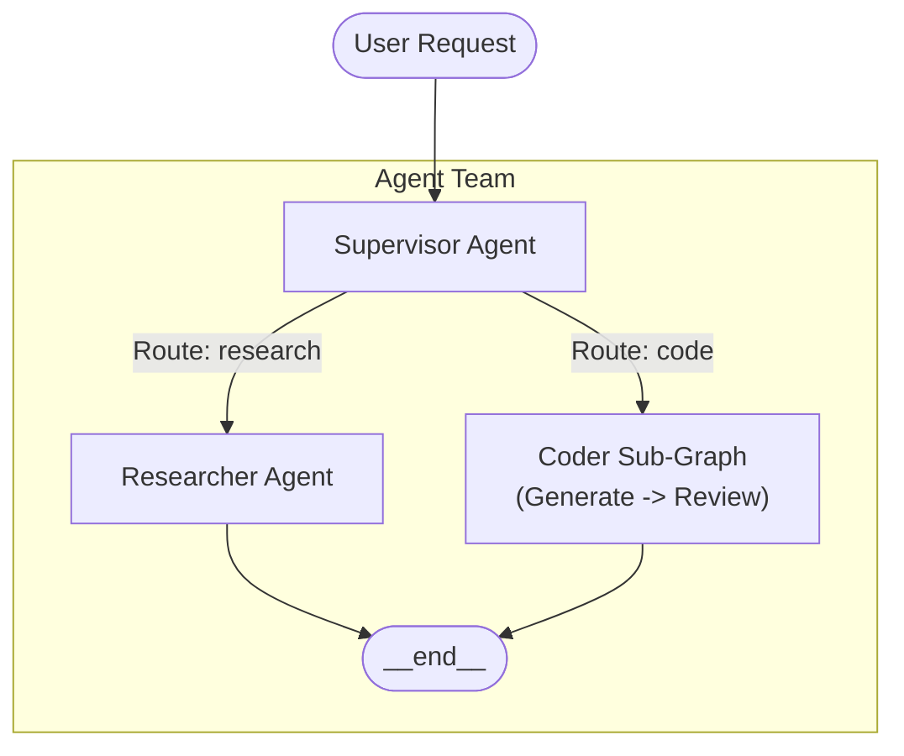

## Multi-Agent Systems in StateGraph

In `langchain-hs`, multi-agent systems are designed as cyclic or hierarchical state machines compiled via `StateGraph`.



---

## 1. Supervisor Routing

A supervisor node evaluates an incoming request and decides which specialized downstream agent to route to. The routing decision updates the graph state, and a conditional edge (`addConditionalEdge`) transitions to the appropriate target node:

```haskell
-- Define parent graph state
data AppState = AppState
  { userPrompt    :: Text
  , selectedRoute :: Text
  , response      :: Text
  } deriving (Show, Eq, Generic, ToJSON, FromJSON)

-- Supervisor node action
supervisorNode :: AppState -> ExceptT LangchainError IO AppState
supervisorNode s = do
  let prompt = "Evaluate task and route to 'coder' or 'researcher': " <> userPrompt s
  resp <- invoke model [userMessage prompt] Nothing
  let route = if "code" `T.isInfixOf` extractMessageText resp then "coderNode" else "researcherNode"
  pure s { selectedRoute = route }

-- Wire conditional routing in StateGraph
graphDef =
  addConditionalEdge "supervisor" (pure . Right . selectedRoute)
    . addNode "supervisor" (liftNode supervisorNode)
    . addNode "researcherNode" (liftNode researcherNode)
    . addNode "coderNode" (liftNode coderNode)
    $ emptyStateGraph replaceFieldReducer
```

---

## 2. Embedded Sub-Graphs (`addSubGraphNode`)

Specialized sub-agent pipelines can be developed, tested, and compiled independently as a sub-graph, then embedded directly into a parent graph as a single node using `addSubGraphNode`:

```haskell
-- 1. Compile sub-graph
compiledSubGraph <- compileGraph coderSubGraphDef

-- 2. Embed sub-graph into parent graph with typed state conversions
let parentGraph =
      addSubGraphNode
        "coderNode"            -- Node identifier in parent graph
        "coderStart"           -- Entry node inside child sub-graph
        compiledSubGraph       -- The compiled child graph
        toChildState           -- (parent -> child) state adapter
        fromChildState         -- (parent -> child -> parent) result reconciler
        emptyParentGraph
```

---

## 3. Lifting Runnables and ChatModels

Any `Runnable` or `ChatModel` can be lifted directly into a `StateGraph` node:

```haskell
-- Lift a ChatModel as a node that updates state
modelNode = chatModelNode model extractMessageText (\s txt -> s { response = txt })

-- Lift an arbitrary Runnable pipeline as a node
toolNode = runnableNode pipeline (\s -> s.userPrompt) (\s out -> s { response = out })
```

---

## 4. State Checkpointing & Time-Travel

StateGraph supports both in-memory STM checkpointing (`MemoryCheckpointer`) and persistent SQLite checkpointing (`SQLiteCheckpointer`). State history can be queried at any point, enabling deterministic replay and debugging of multi-agent interactions.
